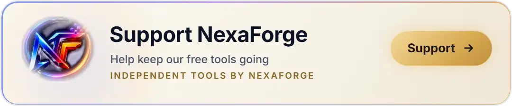

<div align="center">


[](https://github.com/farhan6667/urdu-tts-pronunciation/actions/workflows/ci.yml)
[](LICENSE)


**urdu-tts-pronunciation is a free agent skill and Python toolkit that helps AI text-to-speech voices pronounce Urdu correctly, by fixing the script before audio is made and ranking recorded takes with Whisper.** It's for anyone making Urdu voice-overs, narration, promos or explainers with an AI voice. Built and tested with an OmniVoice voice clone; the checker only listens to audio, so it works on takes from any engine.

<p align="center">
  <a href="https://opencollective.com/nexaforge-oss"><picture>
    <source media="(prefers-color-scheme: dark)" srcset="docs/img/sponsor-button-dark.webp">
    
  </picture></a>
</p>

[Why](#ai-voices-get-urdu-wrong-in-the-same-places) • [Quick start](#quick-start-in-30-seconds) • [The word list](#the-words-and-the-fixes) • [Checking takes](#it-ranks-your-takes-before-you-listen) • [With an AI agent](#use-it-with-claude-code-codex-or-another-agent) • [No coding](#no-coding-paste-a-prompt) • [FAQ](#frequently-asked-questions) • [Contribute](#help-it-learn-more-words)

</div>

---

## AI voices get Urdu wrong in the same places

Urdu is written without most of its short vowels, so a voice has to guess them. It guesses خفیہ as "khafiya" instead of "khufiya", پن as "pan" instead of "pin", and ٹو اسٹیپ as "two steep". English words inside Urdu come out bent too: "click" becomes "kil", WhatsApp turns into "wats-aap". Digits, dates and signs like ﷺ get skipped or read oddly.

You only find out when you listen. Then you change a word, make the audio again, listen again, and the next take gets a different word wrong. This project came out of exactly that: a 4K Urdu TV intro that took a full day of correction rounds. What finally worked is written down here, so the next person gets it right much sooner.

## Quick start in 30 seconds

```bash
git clone https://github.com/farhan6667/urdu-tts-pronunciation
cd urdu-tts-pronunciation
python skills/urdu-tts-pronunciation/scripts/lint_script.py examples/script.txt
```

On macOS and Linux use `python3`. On Windows use `py` if `python` opens the Microsoft Store. The linter needs nothing but Python, and it tells you what to change before you spend a single credit on audio. This is the real output for the five-line [example script](examples/script.txt), trimmed:

```
line 1: [fix] خفیہ  ->  خُفیہ
        Without the pesh the voice reads 'khafiya'. With it, takes say 'khufiya'.
line 1: [fix] اسٹیپ  ->  سٹیپ
        The alif in اسٹیپ turns 'two step' into 'two steep'.
line 2: [fix] دیں  ->  دیجیے
        A final ں drops at a pause: دیں came out as دی, نہ دیں as ندی.
line 4: [check] 3:30  ->  ساڑھے تین بجے
        Engines read digits in Urdu unreliably. Write numbers, dates, times and amounts as words.
line 5: [fix] ﷺ  ->  صلی اللہ علیہ وآلہ وسلم
        Honorific signs are special characters that engines may skip silently.
...
6 to fix, 2 to check by ear.
```

Add `--fix` and it writes `script.fixed.txt` with the safe one-to-one fixes done, leaving only the lines that need a rewrite by hand (like "click"). Use `--json` for tools, or if your terminal shows Urdu letters out of order.

## The words and the fixes

| Write | Not | What the voice did |
|---|---|---|
| خُفیہ (with pesh) | خفیہ | said "khafiya" instead of "khufiya" |
| پِن (with zer) | پن | said PIN as "pan" |
| ٹو سٹیپ | ٹو اسٹیپ | the alif made "two steep" |
| منتخب کیجیے، دبائیے | کلک | "click" came out as "kil" |
| شعبۂ ... | ڈیپارٹمنٹ | the hard ڈ became a soft د in every spelling tried |
| چھین لے | چھن جائے | read as "chhan" |
| پیج | صفحہ | heard as "sufa" |
| خدا نخواستہ | خدانخواستہ | the joined form ran together |
| این سی سی آئی اے | NCCIA | Latin letters inside Urdu are read unpredictably |
| ساڑھے تین بجے، پانچ سو روپے | 3:30، Rs. 500 | digits read unreliably |
| صلی اللہ علیہ وآلہ وسلم | ﷺ | special signs can be skipped silently |

The main trick is the **diacritic**: one pesh or zer on the vowel the voice keeps missing usually fixes it, and readers barely notice it. The [skill](skills/urdu-tts-pronunciation/SKILL.md) also covers polite commands, key words at the end of a paragraph, numbers, dates and money, honorifics, Arabic names and pauses. Every rule, with its reason, is in [`lexicon.json`](skills/urdu-tts-pronunciation/data/lexicon.json). Add your own words with `--lexicon my-words.json`: they're added to the built-in list.

## It ranks your takes before you listen

`check_takes.py` listens to several takes of a line and ranks them. It transcribes each take three times with [faster-whisper](https://github.com/SYSTRAN/faster-whisper):

- **in Urdu**, to see that every word of the script is there;
- **in English**, to see that English words are said as English ("WhatsApp" heard as many times as the script says it);
- **in Devanagari**, because Hindi letters show what Urdu script hides: खुफिया vs खफिया, पिन vs पन, स्टेप vs स्टीप, वाट्स एप vs वाट्स आप, डि vs दि.

It also flags a word said twice in a row and a pause longer than 0.6 seconds. A real run on three takes of one line, trimmed:

```bash
pip install faster-whisper          # and ffmpeg on PATH
python skills/urdu-tts-pronunciation/scripts/check_takes.py --text-file line.txt take2.wav take3.wav take0.wav
```

```
  take2.wav  words 86%  OK
  take3.wav  words 78%  fails: step
  take0.wav  words 82%  fails: whatsapp
  BEST take2.wav  words 86%  (passes every check)
    HI: ... अपने वाट्सेप पर तूस्टेप वरिप्केशन यानी अपना खुफिया पिन लाज्मी आन रख्ये ...
```

For a whole script, name the takes by line and check them all at once:

```bash
python skills/urdu-tts-pronunciation/scripts/check_takes.py --script script.txt "takes/line{n}_*.wav"
```

In the test behind this, eight takes of one line were made with a cloned voice. A person approved only one, and the checker picked the same one. The take with the most words right said "two steep", and it still lost, which is the point. The transcripts are in [`tests/fixtures/takes.json`](tests/fixtures/takes.json) and the tests run on every push.

Speed: about 28 seconds for a 21-second take on a desktop CPU (Intel Core i9-14900K), since each take is transcribed three times. No GPU needed.

## Use it with Claude Code, Codex or another agent

The folder `skills/urdu-tts-pronunciation` is a standard agent skill: a `SKILL.md` with its scripts and data. Copy it where your agent looks for skills:

```bash
# Claude Code
mkdir -p ~/.claude/skills && cp -r skills/urdu-tts-pronunciation ~/.claude/skills/
# Codex CLI
mkdir -p ~/.codex/skills && cp -r skills/urdu-tts-pronunciation ~/.codex/skills/
```

<details>
<summary>Windows (PowerShell)</summary>

```powershell
New-Item -ItemType Directory -Force $HOME\.claude\skills | Out-Null
Copy-Item -Recurse skills\urdu-tts-pronunciation $HOME\.claude\skills\
```
</details>

Then just ask for an Urdu voice-over. The skill makes the agent work in order: the script first (linted and approved), then one checked narration, then any video. It asks about your engine and house rules first, and it doesn't send you a pile of A/B takes to listen to.

## No coding? Paste a prompt

[PROMPT.md](PROMPT.md) has a ready-to-paste prompt for ChatGPT, Gemini or any chat assistant. Paste it before asking for an Urdu script, and the script comes back written the way a voice reads it cleanly.

## What you need

| Tool | Needs |
|---|---|
| `lint_script.py` | Python 3.9 or newer. Nothing else. |
| `check_takes.py` | `pip install faster-whisper`, and ffmpeg on PATH (or `FFMPEG=<path>`). The "small" model downloads once, about 470 MB. |

Your audio and scripts stay on your computer. The only network use is the one-time model download.

## Frequently asked questions

### How do I make ElevenLabs, Azure or another engine pronounce an Urdu word correctly?
Change the spelling in the script first: add the missing short vowel (خُفیہ, پِن), write numbers and signs as words, and spell English words in Urdu letters. Run `lint_script.py` to find these. Then make a few takes and let `check_takes.py` pick the one that says it right.

### Which text-to-speech engines does it work with?
Any of them. The linter works on text, and the take checker only listens to audio files. The word list was built with an OmniVoice voice clone; other engines guess vowels the same way, but some words may differ. Please [tell us how it goes](https://github.com/farhan6667/urdu-tts-pronunciation/issues/new?template=engine-report.yml) with yours.

### Can I use it without an AI agent or without coding?
Yes. Paste [PROMPT.md](PROMPT.md) into any chat assistant. Or run the linter yourself: it's one command and needs only Python.

### Why transcribe Urdu audio in Hindi?
Spoken Urdu and Hindi share most sounds, and Devanagari writes short vowels and hard vs soft consonants that Urdu script leaves out. So when Whisper writes a take in Devanagari, you can see whether the voice said "khufiya" or "khafiya". It's a detector, not a translation.

### Does it need a GPU or the internet?
No GPU: it runs on a normal CPU. The internet is needed once, to download the Whisper model.

### Does it fix the audio by itself?
No. It tells you what to change in the script, fixes the simple spellings with `--fix`, and tells you which take to keep. You still make the audio with your own engine.

### Why not give Whisper the script to make it more accurate?
Because then Whisper fills in words the voice swallowed, and a broken take looks perfect.

### How do I add my own words?
Put them in a JSON file in the same format as `lexicon.json` and pass `--lexicon my-words.json`. Your rules are added to the built-in ones, and a rule with the same `id` replaces the built-in one. If others would benefit, send a [word report](https://github.com/farhan6667/urdu-tts-pronunciation/issues/new?template=word-report.yml).

### Should I use TTS for Quran recitation?
No. Use a real recitation recording. TTS is fine for the narration around it.

### Does it handle Roman Urdu?
Convert Roman Urdu to Urdu script first: an Urdu voice reads Latin letters as English. Roman Urdu scripts aren't checked yet.

## Help it learn more words

The most useful contribution is a **word your voice says wrong**: open a [word report](https://github.com/farhan6667/urdu-tts-pronunciation/issues/new?template=word-report.yml) with the word, what the voice said, the engine, and what fixed it. Engine reports, Devanagari check patterns and false alarms are welcome too. See [CONTRIBUTING.md](CONTRIBUTING.md), and start a [discussion](https://github.com/farhan6667/urdu-tts-pronunciation/discussions) for anything else.

If this saved you a round of re-recording, a star helps other Urdu creators find it.

## Sponsor my work

If your team makes Urdu content and this helps, you can support the work through the [sponsor page](https://github.com/farhan6667/farhan6667/blob/main/SPONSOR.md). A proper payment button is on the way.

## More from SFA

- [no-api-media-mcp](https://github.com/farhan6667/no-api-media-mcp): make images and videos in Claude Code, Cursor or Codex with the AI subscriptions you already pay for.
- [sfa-monitor](https://github.com/farhan6667/sfa-monitor), [wazuh-ruleguard](https://github.com/farhan6667/wazuh-ruleguard), [wazuh-noiselens](https://github.com/farhan6667/wazuh-noiselens), [hexswarm](https://github.com/farhan6667/hexswarm): security and desktop tools.

## License

[MIT](LICENSE): use it, change it and share it freely, in personal or commercial work. An independent project by Syed Farhan Ahmed (SFA) at NexaForge, not affiliated with any text-to-speech provider. See [NOTICE](NOTICE) for the attribution and trademark note, and [SECURITY.md](SECURITY.md) to report a problem privately.

---

<div align="center">

<a href="https://nexaforge.eu.cc/">
  <picture>
    <source media="(prefers-color-scheme: dark)" srcset="https://raw.githubusercontent.com/farhan6667/urdu-tts-pronunciation/main/docs/img/brand/nexaforge-lockup-dark.webp">
    
  </picture>
</a>
&nbsp;&nbsp;&nbsp;
<a href="https://github.com/farhan6667">
  
</a>

**Built by [Syed Farhan Ahmed](https://github.com/farhan6667) (SFA)** at **[NexaForge](https://nexaforge.eu.cc/)**<br>
Cyber security · Vibe coding · Web development and IT infrastructure

<a href="https://nexaforge.eu.cc/">Website</a> ·
<a href="https://www.linkedin.com/in/sfa6667">LinkedIn</a> ·
<a href="https://farhan6667.github.io/portfolio/">Portfolio</a> ·
<a href="mailto:nexaforge.services@gmail.com">Email</a>

</div>
